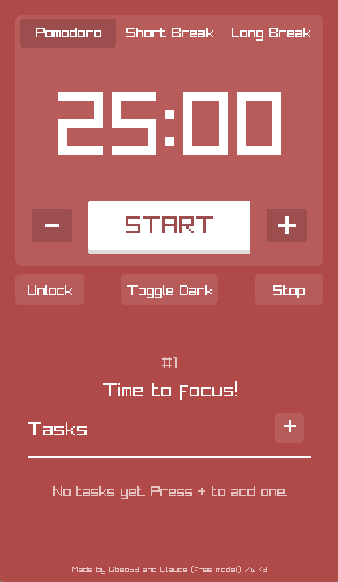

<p align="center">
  
</p>

**[Tải bản mới nhất / Download latest release](https://github.com/Gbdz10/OPtimer/releases/latest)**

---

# OPtimer (Tiếng Việt)

<p align="center">
  
</p>

Đồng hồ Pomodoro viết bằng C++ và raylib.

**Tính năng**
- Ba chế độ: Pomodoro, Short Break, Long Break
- Chỉnh thời gian khi đang dừng (nhấn "Unlock" để mở khóa)
- Danh sách công việc, hoàn thành bằng nút Done
- Chuông khi hết giờ, vẫn kêu khi thu nhỏ cửa sổ
- Hiệu ứng tiếng click và hoạt ảnh nhấn nút Start
- Nút "Toggle Dark" chuyển đổi giữa giao diện tối và sáng

**Yêu cầu**
- CMake 3.16 trở lên, trình biên dịch C++17
- raylib (cài từ nguồn: https://github.com/raysan5/raylib)

**Cài đặt ứng dụng**
- Windows: bộ cài (khuyến nghị Windows 10 trở lên)
- Linux: file AppImage

**Build trên Linux**

```bash
cmake -B build -DCMAKE_BUILD_TYPE=Release
cmake --build build
./build/OPtimer
```

**Build bản Windows (trên Linux, dùng MinGW)**

Trước tiên build raylib cho Windows vào thư mục `~/raylib-win/src`, rồi chạy:

```bash
cmake -B build-win -DCMAKE_TOOLCHAIN_FILE=mingw-toolchain.cmake -DCMAKE_BUILD_TYPE=Release
cmake --build build-win
```

**Giấy phép**
MIT

---

# OPtimer

<p align="center">
  
</p>

A Pomodoro timer written in C++ with raylib.

**Features**
- Three modes: Pomodoro, Short Break, Long Break
- Adjust the time while stopped (press "Unlock" first)
- Task list: finish a task with the Done button
- Chime when time is up, still rings when the window is minimized
- Click sound effect and start button animation
- "Toggle Dark" button switches between dark and light themes

**Requirements**
- CMake 3.16 or newer, a C++17 compiler
- raylib (build from source: https://github.com/raysan5/raylib)

**Installation**
- Windows: installer (Windows 10 or newer recommended)
- Linux: AppImage file

**Build on Linux**

```bash
cmake -B build -DCMAKE_BUILD_TYPE=Release
cmake --build build
./build/OPtimer
```

**Build for Windows (on Linux, using MinGW)**

Build raylib for Windows first, into `~/raylib-win/src`, then run:

```bash
cmake -B build-win -DCMAKE_TOOLCHAIN_FILE=mingw-toolchain.cmake -DCMAKE_BUILD_TYPE=Release
cmake --build build-win
```

**License**
MIT
